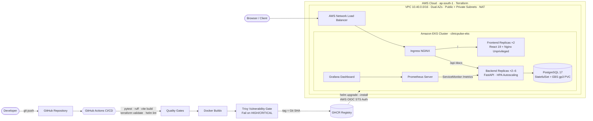

# ClinicPulse: Healthcare Scheduling & Triage Platform (DevOps Capstone)

[](https://github.com/TejasKumat8/clinicpulse-devops-capstone/actions/workflows/ci-cd.yml)
[](https://github.com/TejasKumat8/clinicpulse-devops-capstone/pkgs/container/clinicpulse-backend)
[](docs/TRIVY.md)
[](https://kubernetes.io/)
[](https://helm.sh/)

**ClinicPulse** is an enterprise-grade outpatient scheduling, clinical triage, and consultation management system built for multi-specialty healthcare centers. It streamlines the front-desk patient arrival workflow, prevents doctor schedule conflicts, supports both in-person visits and teleconsultations, and tracks every patient consultation from arrival to completion.

Engineered and automated across the complete cloud-native DevOps lifecycle:
**FastAPI + React 19 → Pytest → Docker (Non-Root) → GitHub Actions → Trivy Security Gate → GHCR → Terraform (AWS VPC + Amazon EKS) → Helm 3 → Ingress NGINX → HPA Autoscaling → Prometheus & Grafana**.

> **Author:** Tejas Kumat (`TejasKumat8`). Session 21 Final DevOps Capstone Project.

---

## Contents

1. [Features & Capabilities](#1-features--capabilities)
2. [System Architecture](#2-system-architecture)
3. [Repository Layout](#3-repository-layout)
4. [Running Locally (Docker Compose)](#4-running-locally-docker-compose)
5. [REST API Documentation](#5-rest-api-documentation)
6. [Testing & Quality Gates](#6-testing--quality-gates)
7. [Docker Multi-Stage Builds & Security](#7-docker-multi-stage-builds--security)
8. [Automated CI/CD Pipeline](#8-automated-cicd-pipeline)
9. [Trivy Vulnerability Scanning](#9-trivy-vulnerability-scanning)
10. [Terraform (AWS VPC + Amazon EKS)](#10-terraform-aws-vpc--amazon-eks)
11. [Kubernetes Orchestration & Helm](#11-kubernetes-orchestration--helm)
12. [Observability & Monitoring](#12-observability--monitoring)
13. [Troubleshooting & Failure Simulation](#13-troubleshooting--failure-simulation)
14. [Safe Resource Teardown](#14-safe-resource-teardown)

---

## 1. Features & Capabilities

| Feature | Operational Mechanism |
|---|---|
| **Patient Consultation Scheduling** | Collects patient details, phone number, department, clinician, scheduled start, duration (10–120 min), symptoms, consultation mode (In-Person vs Teleconsult), and clinical notes. |
| **Strict Conflict Prevention** | Real-time interval overlap algorithm guarantees clinicians never have overlapping active bookings; responds with `409 Conflict`. |
| **Consultation Lifecycle Workflow** | State engine enforcing: `SCHEDULED → CHECKED_IN → COMPLETED`. Slots can transition to `CANCELLED` or `NO_SHOW` (releasing the doctor's calendar for rebooking). Completed records are locked. |
| **Real-Time Clinical Dashboard** | Displays live KPI counters (Today's visits, waiting in clinic, completed, teleconsultations, cancellations), searchable directory, and today's chronological queue. |
| **Specialist Directory & Staffing** | Multi-department coverage (Cardiology, Pediatrics, Orthopedics, Dermatology, Neurology, General Medicine) with cabin allocation and dynamic registration. |
| **Deployment Traceability** | The footer and system info expose the exact Git commit SHA of the container build currently serving traffic (`/api/info`). |

---

## 2. System Architecture



---

## 3. Repository Layout

```text
.
├── backend/                      FastAPI service
│   ├── app/                      main.py, routers/, models.py, schemas.py, services.py, metrics.py, db.py, config.py
│   ├── alembic/                  versions/ (0001_create_doctors, 0002_create_appointments with appointment_type)
│   ├── tests/                    41 pytest test cases + conftest.py (isolated in-memory SQLite)
│   ├── Dockerfile                Multi-stage build, non-root (UID 10001), pip removed from runtime
│   ├── docker-entrypoint.sh      Automated database migration gate -> uvicorn startup
│   └── requirements*.txt, pytest.ini, ruff.toml
├── frontend/                     React 19 + Vite dashboard
│   ├── src/                      App.jsx, components/, lib/ (with node:test unit tests), api.js, styles.css
│   ├── nginx.conf.template       Unprivileged reverse-proxy configuration (port 8080)
│   └── Dockerfile                Multi-stage: Node 22 build -> nginx-unprivileged runtime (UID 101)
├── docker-compose.yml            PostgreSQL + Backend + Frontend local orchestration
├── helm/clinicpulse/             Production Helm 3 package
│   ├── templates/                Deployments, Services, Ingress, HPA, PDBs, StatefulSet, ServiceMonitor
│   └── dashboards/               ClinicPulse Grafana dashboard JSON
├── k8s/                          Restricted namespace and EBS gp3 storage class manifests
├── monitoring/                   Values for ingress-nginx and kube-prometheus-stack
├── terraform/                    AWS VPC, EKS 1.31, Managed Node Group, GitHub OIDC IAM Role
├── troubleshooting/              Broken manifests & incident response runbook (RUNBOOK.md)
├── scripts/                      Demo data seeder, load generator, cluster bootstrap & teardown
└── docs/                         SUBMISSION.md (Rubric evidence), TRIVY.md (Security analysis), DEMO.md
```

---

## 4. Running Locally (Docker Compose)

Launch the full multi-tier containerized stack with healthcheck dependency ordering:

```bash
# 1. Build and start containers
docker compose up --build -d

# 2. Verify all three services are healthy
docker compose ps

# 3. Seed realistic clinical appointment records
python scripts/seed_demo_data.py

# 4. Access ClinicPulse
# Dashboard UI : http://localhost:3000
# API Docs     : http://localhost:8000/docs
# Metrics      : http://localhost:8000/metrics
```

To stop and remove containers:
```bash
docker compose down -v
```

---

## 5. REST API Documentation

The FastAPI backend exposes 14 REST endpoints, fully documented via interactive OpenAPI/Swagger at `/docs`:

| Method | Endpoint | Description | Query / Body Parameters |
|---|---|---|---|
| `GET` | `/health` | Liveness probe: verifies process responsiveness | None |
| `GET` | `/ready` | Readiness probe: validates PostgreSQL database query | None |
| `GET` | `/api/info` | Deployment metadata and running Git commit SHA | None |
| `GET` | `/metrics` | Prometheus metrics scrape endpoint | None |
| `GET` | `/api/doctors` | List all active doctors in clinical roster | None |
| `POST` | `/api/doctors` | Register a new doctor into the clinic | `DoctorCreate` payload |
| `GET` | `/api/doctors/{id}` | Retrieve doctor details | `id: int` |
| `GET` | `/api/appointments` | List appointments with multi-criteria filtering | `status`, `department`, `type`, `on`, `q`, `limit` |
| `GET` | `/api/appointments/stats` | Aggregated KPIs, status totals, and department metrics | None |
| `GET` | `/api/appointments/{id}` | Retrieve specific appointment record | `id: int` |
| `POST` | `/api/appointments` | Schedule appointment with conflict checking | `AppointmentCreate` payload |
| `PUT` | `/api/appointments/{id}` | Update details, reschedule, or transition status | `AppointmentUpdate` payload |
| `DELETE` | `/api/appointments/{id}` | Cancel and remove appointment record | `id: int` |

---

## 6. Testing & Quality Gates

The backend test suite runs **41 comprehensive Pytest test cases** providing extensive test coverage across domain logic, scheduling edge cases, concurrency conflicts, and HTTP routers.

```bash
cd backend
pytest -v --cov=app --cov-report=term-missing
```

### Key Testing Architecture
- **In-Memory SQLite Isolation:** `tests/conftest.py` configures a separate in-memory SQLite database using `StaticPool` and FastAPI `dependency_overrides`. Tests never pollute the production or development database.
- **Frontend Unit Tests:** `frontend/src/lib/appointments.test.js` tests date calculations, state transitions, and filtering using Node's native test runner (`node --test`).

---

## 7. Docker Multi-Stage Builds & Security

Both services are packaged using multi-stage Docker builds configured for minimal attack surfaces:

- **Backend (`backend/Dockerfile`):**
  - Stage 1 compiles wheels in virtualenv.
  - Stage 2 copies only virtual environment, installs OS security updates, and **completely removes `pip` and `ensurepip`** from the runtime container.
  - Runs as numeric non-root user `UID 10001:10001`.
- **Frontend (`frontend/Dockerfile`):**
  - Stage 1 runs `npm test` and `vite build` on Node 22 Alpine.
  - Stage 2 serves pre-compiled static assets using `nginxinc/nginx-unprivileged:1.29-alpine`.
  - Runs as non-root user `UID 101` on unprivileged port `8080`.

Verify non-root execution locally:
```bash
docker compose exec backend id    # uid=10001(app) gid=10001(app)
docker compose exec frontend id   # uid=101(nginx) gid=101(nginx)
```

---

## 8. Automated CI/CD Pipeline

The GitHub Actions workflow (`.github/workflows/ci-cd.yml`) executes on every push to `main` and on pull requests:

1. **Quality Gates:**
   - `backend-tests`: Ruff linting & formatting check + Pytest suite with XML & coverage reports.
   - `postgres-integration`: Live PostgreSQL container testing reversible Alembic migrations (`upgrade -> downgrade -> upgrade`).
   - `frontend-build`: `npm test` and production `vite build`.
   - `infra-validate`: `terraform fmt -check`, `terraform validate`, and `helm lint`.
2. **Container Build & Security:**
   - Multi-stage build for both backend and frontend images.
   - **Trivy Vulnerability Scan:** Hard failure on any fixable `HIGH` or `CRITICAL` vulnerability.
   - Image published to GHCR tagged with immutable Git SHA: `ghcr.io/tejaskumat8/clinicpulse-<service>:${{ github.sha }}`.
3. **Continuous Deployment:**
   - Keyless authentication to AWS via OIDC IAM STS federation (no static AWS keys).
   - Upgrades Helm release with `--rollback-on-failure`.
   - Executes smoke tests validating that the live ingress is actively serving the newly committed Git SHA.

---

## 9. Trivy Vulnerability Scanning

Trivy scans both container images in the CI pipeline. Our configuration strictly fails the build upon discovering unpatched HIGH or CRITICAL CVEs.

Details on the vulnerabilities found and remediated (including `urllib3` CVE-2026-97687 and `msgpack` GHSA-6v7p-g79w-8964 vendored inside pip) are documented in [docs/TRIVY.md](docs/TRIVY.md).

Both production containers maintain **0 HIGH and 0 CRITICAL vulnerabilities**.

---

## 10. Terraform (AWS VPC + Amazon EKS)

The `terraform/` directory defines the complete AWS cloud infrastructure:
- **VPC (`10.40.0.0/16`):** Spans two availability zones (`ap-south-1a`, `ap-south-1b`) with 2 public subnets (`10.40.100.0/24`, `10.40.101.0/24`) and 2 private subnets (`10.40.1.0/24`, `10.40.2.0/24`).
- **NAT Gateway:** Outbound internet access for worker nodes to pull GHCR images securely.
- **Amazon EKS (1.31):** Managed control plane with Amazon Linux 2023 managed node group (`t3.large`).
- **Cluster Addons:** VPC CNI, CoreDNS, Kube-Proxy, EBS CSI Driver, Pod Identity Agent.
- **OIDC IAM Role:** Keyless STS deployment role for GitHub Actions.

```bash
cd terraform
terraform init
terraform plan
terraform apply
```

---

## 11. Kubernetes Orchestration & Helm

The Helm chart in `helm/clinicpulse` provides production-grade Kubernetes orchestration:
- **Zero-Downtime Rollouts:** RollingUpdate with `maxSurge: 1, maxUnavailable: 0`.
- **Health Probes:** Liveness probe on `/health` (lightweight process check) and Readiness probe on `/ready` (verifies database availability).
- **High Availability:** PodDisruptionBudgets (`minAvailable: 1`) preventing accidental node drainage outages.
- **Horizontal Pod Autoscaling (HPA):** Dynamically scales backend pods from 2 to 6 replicas when average CPU exceeds 60%.
- **Persistence:** PostgreSQL deployed as a `StatefulSet` with `gp3` EBS PersistentVolumeClaims.
- **Network Ingress:** NGINX Ingress controller routes `/` to the frontend and `/api` to the backend.

```bash
# Verify Helm release and pods
helm list -n clinicpulse
kubectl get pods,svc,ingress,hpa -n clinicpulse
helm test clinicpulse -n clinicpulse
```

---

## 12. Observability & Monitoring

- **Custom Application Metrics:** `/metrics` exposes Prometheus counters for appointment bookings by department and consultation mode (`clinicpulse_appointments_booked_total`), status changes (`clinicpulse_appointment_status_changes_total`), and schedule conflicts (`clinicpulse_booking_conflicts_total`).
- **ServiceMonitor:** Auto-discovered by the Prometheus Operator using label `release: kube-prometheus-stack`.
- **Grafana Dashboard:** `helm/clinicpulse/dashboards/clinicpulse.json` automatically provisioned via sidecar into Grafana with panels for request throughput, P95 latency, pod CPU/memory consumption, HPA replica counts, and departmental workloads.

---

## 13. Troubleshooting & Failure Simulation

The `troubleshooting/` directory contains three reproducible failure simulations:
1. **`broken-image.yaml`:** Simulates `ImagePullBackOff` caused by a non-existent container tag.
2. **`broken-service.yaml`:** Simulates a Service without endpoints due to label selector mismatch.
3. **`broken-readiness.yaml`:** Simulates a container running but never ready due to probe port misconfiguration.

Follow [troubleshooting/RUNBOOK.md](troubleshooting/RUNBOOK.md) for detailed diagnostic commands and remediations.

---

## 14. Safe Resource Teardown

To prevent unnecessary AWS cloud spend, execute the automated teardown script:

```bash
./scripts/teardown-aws.sh
```

---

### Capstone Attribution
- **Candidate:** Tejas Kumat
- **Repository:** [https://github.com/TejasKumat8/clinicpulse-devops-capstone](https://github.com/TejasKumat8/clinicpulse-devops-capstone)
- **License:** MIT
